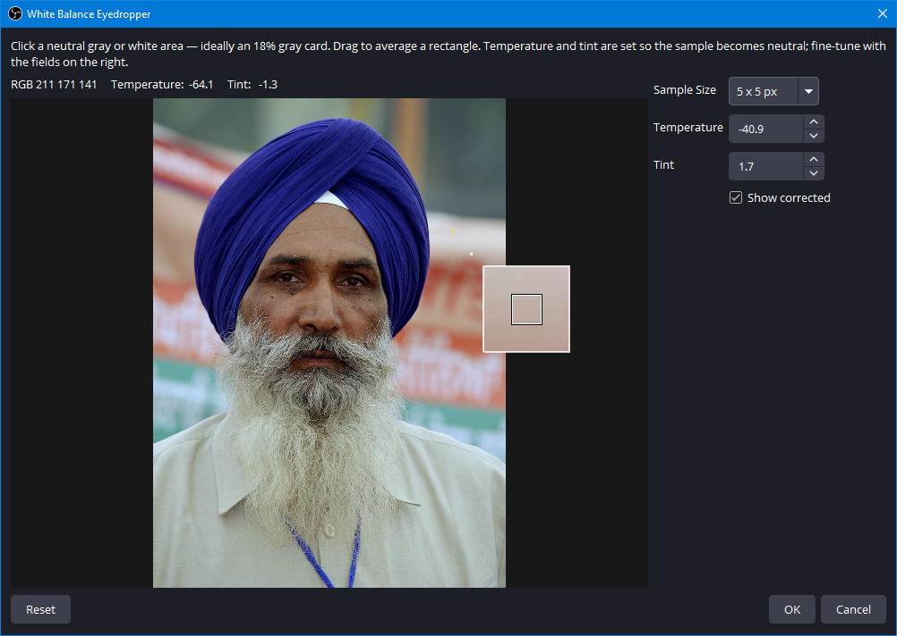

# White Balance Eyedropper

A video filter for OBS Studio that brings Premiere Pro's **Lumetri Color → Basic Correction → WB Selector** to OBS. You click a neutral target (ideally an 18% gray card) with an eyedropper, and the filter sets **Temperature** and **Tint** so that the patch becomes neutral. Sliders with spin boxes let you fine-tune the result.



<sub>Screenshot shows [“Sikh man, Agra 10”](https://commons.wikimedia.org/wiki/File:Sikh_man,_Agra_10.jpg), © Yann Forget / Wikimedia Commons, licensed [CC BY-SA 3.0](https://creativecommons.org/licenses/by-sa/3.0/). The photo is shown with white balance adjustments applied. The screenshot is licensed under CC BY-SA 3.0.</sub>

## Install
Download the latest build for macOS (universal: Apple Silicon and Intel) or Windows (x64) from the [Releases page](https://github.com/Armitage64/obs-whitebalance/releases). Install steps are in [`docs/INSTALL.md`](docs/INSTALL.md). Changes per version are in [`CHANGELOG.md`](CHANGELOG.md).

## Usage
1. Right-click a video source (e.g. *FaceTime HD Camera*) and choose **Filters**. Click **+** and add **White Balance**.
2. Click the **eyedropper button** to the right of the **Sample Size** dropdown. A window opens with a live, *uncorrected* view of the source.
3. Hover to see a magnified loupe and the sample box. A live RGB / Temperature / Tint readout runs along the top of the image.
   - **Click** to sample the chosen area (1–31 px square).
   - **Drag** to average a rectangle, such as a whole gray card.
4. The correction shows live in OBS. To fine-tune, use the Temperature/Tint fields in the picker or the sliders in the filter properties.
   - **OK** keeps the values.
   - **Cancel** restores the previous values.
   - **Reset** sets both to 0.

Sign conventions match Lumetri:
- **+Temperature** is warmer (orange); −Temperature is cooler (blue).
- **+Tint** is magenta; −Tint is green.
- Both range from −100 to 100.

The source must be visible in Preview or Program, and the filter enabled, for the picker to receive frames. If the source sends only black frames (e.g. a capture card with no signal), the picker says so.

Make sure you add the filter to the source you actually want to correct. A source hidden underneath another one in the scene still renders, but you won't see it in the preview.

## How it works
- Correction is a per-channel gain applied in **linear light**: sRGB is decoded, multiplied, then re-encoded. Rec.709 luminance of neutrals is preserved.
- **Model:**
  - log2 gR = T/100 + M/150
  - log2 gB = −T/100 + M/150
  - log2 gG = −2M/150
  - So ±100 Temperature is ±2 stops of R/B and ±100 Tint is ±2 stops of G vs. magenta.
- **Solving a sample:** the eyedropper averages the sample in linear RGB and solves T and M in closed form so the sample becomes R = G = B.
- **Rejected samples:** too dark (any channel < 0.003 linear) or clipped (≥ 0.95 linear) samples are refused with a message.
- **Rendering:** the filter renders its input into its own texture, which drives both the corrected output and the eyedropper snapshot. The snapshot reaches the CPU through a staging surface, read one frame late so the GPU doesn't stall. Color spaces handled: SRGB, SRGB_16F and 709_EXTENDED (HDR).

## Build
The first configure downloads OBS sources, obs-deps and Qt6 (see `buildspec.json`).

**macOS** (Xcode). The output is a universal (arm64 + x86_64) bundle:
```sh
cmake --preset macos
cmake --build --preset macos
cp -R build_macos/RelWithDebInfo/obs-whitebalance.plugin \
  ~/Library/Application\ Support/obs-studio/plugins/
```

**Windows** (Visual Studio 2022 with the "Desktop development with C++" workload, CMake 3.28+):
```powershell
cmake --preset windows-x64
cmake --build --preset windows-x64
cmake --install build_x64 --prefix release --config RelWithDebInfo
```
Then copy `release\obs-whitebalance` into `C:\ProgramData\obs-studio\plugins\`.

**Linux** (Ubuntu 24.04, **untested**): `cmake --preset ubuntu-x86_64 && cmake --build --preset ubuntu-x86_64`. This needs the OBS and Qt6 development packages; see `.github/scripts/utils.zsh/setup_ubuntu`. CI builds Linux only to check the code compiles. No Linux packages are released, because the plugin hasn't been tested on Linux, and Ubuntu's own OBS packages (30.x) are older than the supported OBS 31+.

### Continuous integration
GitHub Actions (`.github/workflows`, from obs-plugintemplate) builds macOS, Windows and Ubuntu (compile check only) on every push to `main`. It also checks formatting (clang-format 19, gersemi).

Pushing a version tag such as `v0.2.0` also creates a **draft** GitHub release with the macOS and Windows packages and checksums attached. Review the draft and publish it. Bump `version` in `buildspec.json` and update `CHANGELOG.md` before tagging.

### Unit tests (no OBS needed)
```sh
cmake -S tests -B build_tests && cmake --build build_tests && ctest --test-dir build_tests
```

### Manual test card
`tests/graycard_tungsten_cast.png` is an 18% gray card with a known tungsten-like cast (linear gains 1.4 / 1.0 / 0.7).
1. Add it as an Image source and add the filter.
2. Click the center patch.
3. Expect **Temperature ≈ −50.0, Tint ≈ +0.7**. The patch should read R ≈ G ≈ B ≈ 118.

## Notes
- The eyedropper lives in its own window because the OBS plugin API can't intercept clicks on the main preview.
- **Properties-panel layout.** OBS's generic properties panel has no API for button icons, field widths or putting two properties on one row. `src/wb-ui.cpp` installs a Qt event filter that recognizes this plugin's widgets as OBS builds them: the pick button by its label, the Sample Size dropdown by its tooltip. The filter then:
  - turns the button into an eyedropper icon (drawn in code, following the theme's text color);
  - stops the dropdown from stretching;
  - moves the button onto the dropdown's row.

  If a future OBS changes how it builds that panel, these widgets fall back to OBS's default look. Nothing breaks.
- **Logging.** The OBS log records each eyedropper capture (source, size, color space, first-frame stats) under `[obs-whitebalance]`.
- Scaffolded from [obs-plugintemplate](https://github.com/obsproject/obs-plugintemplate). Local changes to the template:
  - `cmake/common/buildnumber.cmake` defaults the build number outside CI.
  - `CMakeLists.txt` drops Qt's `-framework AGL`, which current macOS SDKs no longer ship.
- The UI conventions (grouping, sign tooltips) were inspired by the Lua script *Lumetric Corrector*. No code from it is used.

## Reporting issues
Report bugs and requests on [GitHub Issues](https://github.com/Armitage64/obs-whitebalance/issues). Include your OS, OBS version, and the `[obs-whitebalance]` lines from the OBS log.

## AI disclosure
This plugin was written with substantial help from an AI coding assistant: Anthropic's Claude, used through Claude Code. The assistant wrote most of the source code, build and CI configuration, and documentation, working from the maintainer's requirements and feedback. The maintainer defined the features and UI, tested every build in OBS on macOS and Windows, and decides what is released.

## License
GPL-2.0-or-later. This is a third-party plugin and is not affiliated with or endorsed by the OBS Project.
