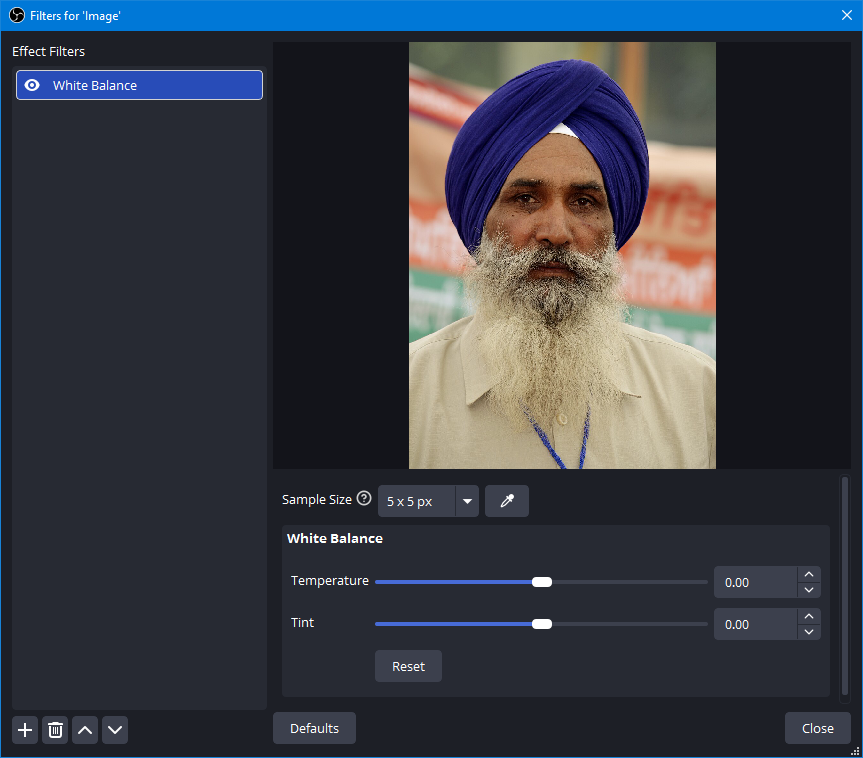

# White Balance Eyedropper

A video filter for OBS Studio based on Adobe Premiere's Lumetri Color White Balance Eyedropper. Just select a neutral target (ideally an 18% gray card) and the filter sets **Temperature** and **Tint** automatically. Sliders and spin boxes let you fine-tune the result.

## Install
Download the latest build for macOS (universal: Apple Silicon and Intel) or Windows (x64) from the [Releases page](https://github.com/Armitage64/obs-whitebalance/releases). Install steps are in [`docs/INSTALL.md`](docs/INSTALL.md). Changes per version are in [`CHANGELOG.md`](CHANGELOG.md).

## Usage
1. Right-click a video source (e.g. *FaceTime HD Camera*) and choose **Filters**. Click **+** and add **White Balance**.
2. Click the **eyedropper button** to the right of the **Sample Size** dropdown. A window opens with a live, *uncorrected* view of the source.
3. Hover to see a magnified loupe and the sample box. A live RGB / Temperature / Tint readout runs along the top of the image.
   - **Click** to sample the chosen area (1–31 px square).
   - **Drag** to average a rectangle, such as a whole gray card.
4. The correction shows live in OBS. To fine-tune, use the Temperature/Tint fields in the picker or the sliders in the filter properties.
   - **OK** keeps the values.
   - **Cancel** restores the previous values.
   - **Reset** sets both to 0.

[“Sikh man, Agra 10”](https://commons.wikimedia.org/wiki/File:Sikh_man,_Agra_10.jpg), © Yann Forget / Wikimedia Commons, licensed [CC BY-SA 3.0](https://creativecommons.org/licenses/by-sa/3.0/). The screenshot is licensed under CC BY-SA 3.0.

Sign conventions match Lumetri:
- **+Temperature** is warmer (orange); −Temperature is cooler (blue).
- **+Tint** is magenta; −Tint is green.
- Both range from −100 to 100.

The source must be visible in Preview or Program, and the filter enabled, for the picker to receive frames. If the source sends only black frames (e.g. a capture card with no signal), the picker says so.

Make sure you add the filter to the source you actually want to correct. A source hidden underneath another one in the scene still renders, but you won't see it in the preview.

## How it works
- Correction is a per-channel gain applied in **linear light**: sRGB is decoded, multiplied, then re-encoded. Rec.709 luminance of neutrals is preserved.
- **Model:**
  - log2 gR = T/100 + M/150
  - log2 gB = −T/100 + M/150
  - log2 gG = −2M/150
  - So ±100 Temperature is ±2 stops of R/B and ±100 Tint is ±2 stops of G vs. magenta.
- **Solving a sample:** the eyedropper averages the sample in linear RGB and solves T and M in closed form so the sample becomes R = G = B.
- **Rejected samples:** too dark (any channel < 0.003 linear) or clipped (≥ 0.95 linear) samples are refused with a message.
- **Rendering:** the filter renders its input into its own texture, which drives both the corrected output and the eyedropper snapshot. The snapshot reaches the CPU through a staging surface, read one frame late so the GPU doesn't stall. Color spaces handled: SRGB, SRGB_16F and 709_EXTENDED (HDR).

## Development
Building from source, CI and releases, tests, and implementation notes are in [`docs/DEVELOPMENT.md`](docs/DEVELOPMENT.md).

## Reporting issues
Report bugs and requests on [GitHub Issues](https://github.com/Armitage64/obs-whitebalance/issues). Include your OS, OBS version, and the `[obs-whitebalance]` lines from the OBS log.

## AI disclosure
This plugin was written with substantial help from an AI coding assistant: Anthropic's Claude, used through Claude Code. 

## License
GPL-2.0-or-later. This is a third-party plugin and is not affiliated with or endorsed by the OBS Project.
